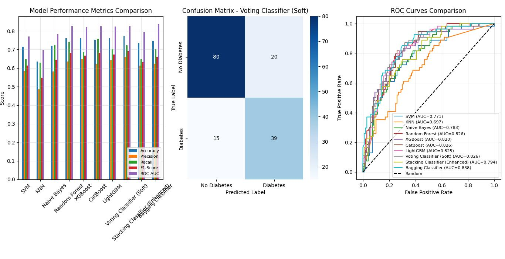
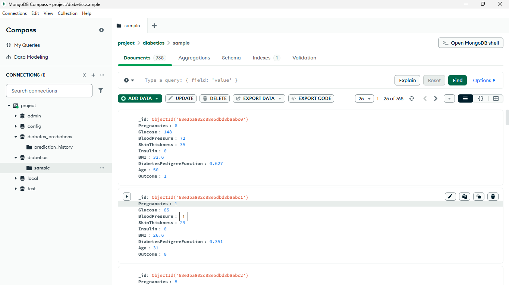
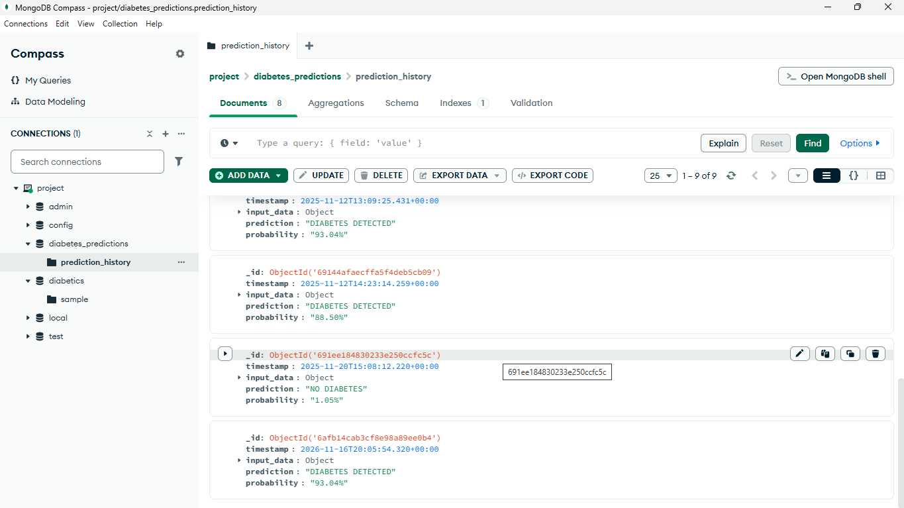
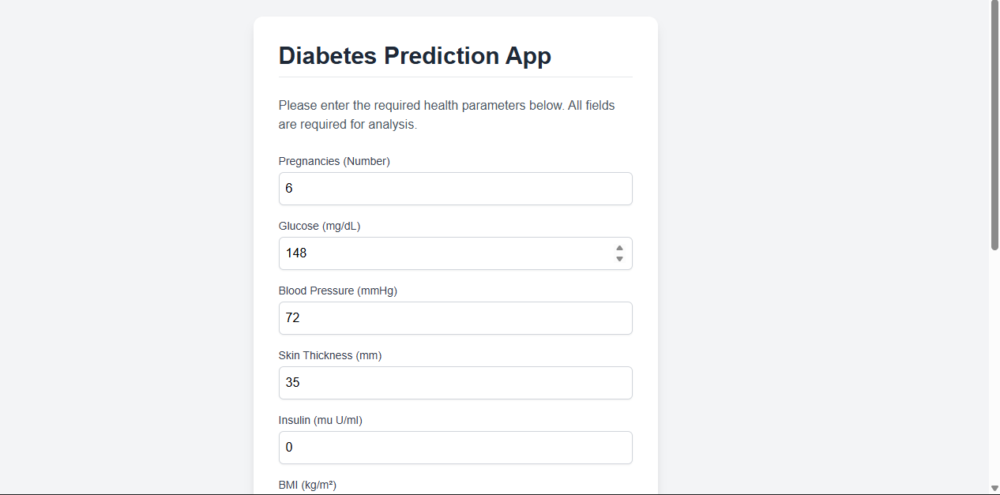
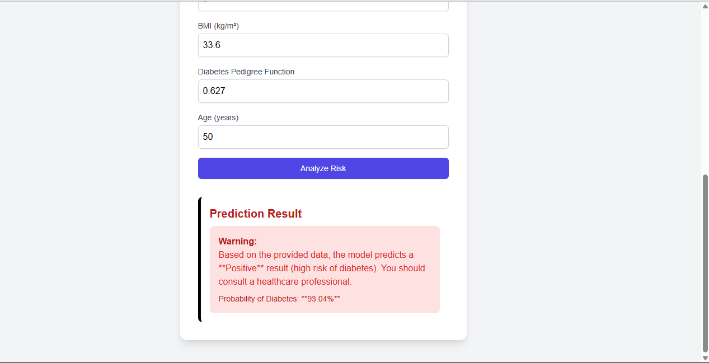

# End-to-End Diabetes Prediction System with MongoDB & Flask

An enterprise-grade, full-stack machine learning web application that predicts diabetes risk using an optimized Soft Voting Classifier pipeline. This system features dynamic data storage via MongoDB, real-time web risk assessment using Flask and Tailwind CSS, and automatic logging of all prediction history for future medical data analysis.

---

## 📂 Dataset & Features
The model is trained on the **Pima Diabetes Dataset** sourced from Kaggle. The dataset captures essential diagnostic and physiological health indicators used to predict the likelihood of diabetes:

* **Dataset Source:** [Kaggle - Pima Diabetes Dataset](https://www.kaggle.com/datasets/tariqmhmd5/pima-diabetes-dataset)
* **Core Feature Attributes:**
  * **Pregnancies:** Number of times pregnant
  * **Glucose:** Plasma glucose concentration (2 hours in an oral glucose tolerance test)
  * **BloodPressure:** Diastolic blood pressure (mm Hg)
  * **SkinThickness:** Triceps skin fold thickness (mm)
  * **Insulin:** 2-Hour serum insulin ($\mu$U/ml)
  * **BMI:** Body mass index ($\text{weight in kg}/(\text{height in m})^2$)
  * **DiabetesPedigreeFunction:** Diabetes pedigree function (genetic scoring)
  * **Age:** Age (years)
  * **Outcome:** Target class label (`0` for non-diabetic, `1` for diabetic)

---

## 📊 Model Performance & Evaluation
Our rigorous pipeline evaluates multiple algorithms (SVM, KNN, Naive Bayes, Random Forest, XGBoost, CatBoost, LightGBM) before deploying an optimized **Soft Voting Classifier**.



---

## 🗄️ Database Architecture & Storage (MongoDB)
The application connects seamlessly to **MongoDB** for two primary operations:
1. **Dataset Storage (`diabetics.sample`):** Source patient health metrics and target outcomes stored for robust pipeline training.
2. **Prediction History Logging (`diabetes_predictions.prediction_history`):** Every analysis performed on the website is logged with timestamps, input features, predicted status, and probability scores.

**1. Training Data Collection (`diabetics.sample`):**
- Stores historical health parameters including Pregnancies, Glucose, Blood Pressure, Skin Thickness, Insulin, BMI, Diabetes Pedigree Function, Age, and Outcome.


**2. Prediction History Logging (`prediction_history`):**
- Automatically records timestamps, input parameters, and model outputs for auditing and downstream analysis.


---

## 💻 Web Application Interface
Built with Flask and styled with Tailwind CSS for a modern, responsive user experience.

**Input Form:**


**Real-Time Risk Analysis & Output:**


---

## 🚀 Step-by-Step Installation & Execution

1. **Clone the repository:**
   ```bash
   git clone [https://github.com/muniprasad1/diabetes-prediction-app.git](https://github.com/muniprasad1/diabetes-prediction-app.git)
   cd diabetes-prediction-app
